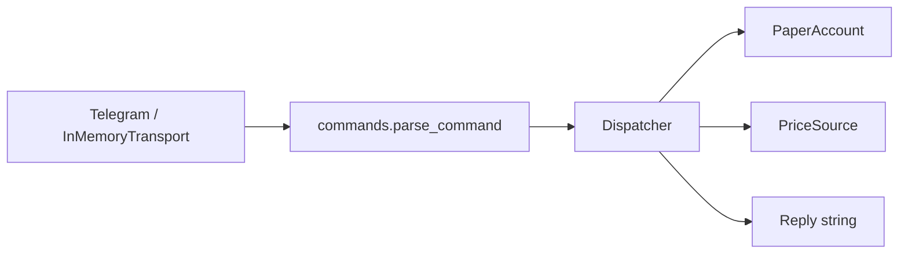

<p align="center">
  
</p>

<h1 align="center">Telegram Crypto Trading Bot</h1>

<p align="center">
  <strong>Telegram-controlled crypto trading bot — a typed command parser and a paper-trading engine, in Python.</strong><br>
  Type <code>/buy BTC 0.5</code>, <code>/sell</code>, <code>/price</code>, <code>/balance</code> — the transport is abstracted, so it runs and tests with no Telegram token.
</p>

<p align="center">
  <em>Built and maintained by <a href="https://viprasol.com">Viprasol Tech</a> — Fintech Experts. Full-Stack Builders.</em>
</p>

<p align="center">
  <a href="https://github.com/Viprasol-Tech/telegram-crypto-trading-bot/actions/workflows/ci.yml"></a>
  <a href="LICENSE"></a>
  
  <a href="https://t.me/viprasol_help"></a>
  <a href="https://github.com/Viprasol-Tech/telegram-crypto-trading-bot/stargazers"></a>
</p>

---

> ## ⚠️ Disclaimer
> This software is for **educational purposes only** and is **not financial advice**. Cryptocurrency trading is highly volatile and involves substantial risk, including the **total loss of capital**. The included engine is a **paper-trading simulator** — it does not place real orders. Always test thoroughly and comply with each platform's terms and your local laws. **Use at your own risk** — Viprasol Tech assumes no responsibility for your trading results.

---

## ✨ Features

- 💬 **Telegram-style command parser** — `/buy`, `/sell`, `/balance`, `/price` into typed, validated `Command` objects.
- 🛡️ **Strict validation** — malformed input raises `CommandError`; positive-quantity and known-symbol checks built in.
- 🧾 **Paper account** — cash, positions, buy/sell fills, equity marking — no API keys, no real money.
- 🔌 **Abstracted transport** — a `Transport` protocol with an `InMemoryTransport` fake; runs and tests without a token.
- 🧠 **Pure dispatcher** — `command + price source -> reply string`, trivial to test and extend.
- 🖥️ **CLI** — `telegram-crypto-trading-bot demo` runs a full command session end-to-end.
- ⚙️ **Modern tooling** — ruff, mypy (strict), pytest, GitHub Actions CI.

## 🚀 Quickstart

```bash
git clone https://github.com/Viprasol-Tech/telegram-crypto-trading-bot.git
cd telegram-crypto-trading-bot
python -m pip install -e ".[dev]"

# Feed a sample command session through the bot and print replies:
telegram-crypto-trading-bot demo
```

## 🧩 Drive the bot in code

```python
from telegram_crypto_trading_bot.bot import Dispatcher, StaticPriceSource
from telegram_crypto_trading_bot.paper import PaperAccount

prices = StaticPriceSource({"BTC": 30_000.0})
bot = Dispatcher(PaperAccount(cash=20_000.0), prices)

print(bot.handle_text("/buy BTC 0.5"))  # BOUGHT 0.5 BTC @ 30000.00 ...
print(bot.handle_text("/balance"))      # Cash 5000.00 | Positions: BTC 0.5
print(bot.handle_text("/price BTC"))    # BTC = 30000.00
```

## 🏗️ Architecture



## 🗺️ Roadmap

- [x] Typed command parser with strict validation
- [x] Paper account + dispatcher + in-memory transport
- [ ] Live Telegram adapter (python-telegram-bot)
- [ ] Live price feed adapters (ccxt / exchange websockets)
- [ ] Stop-loss / take-profit and portfolio commands

## 🤝 Contributing

PRs welcome — see [CONTRIBUTING.md](CONTRIBUTING.md) and our [Code of Conduct](CODE_OF_CONDUCT.md).

## Contact — Viprasol Tech Private Limited

- Website: [viprasol.com](https://viprasol.com)
- Email: [support@viprasol.com](mailto:support@viprasol.com)
- Telegram: [t.me/viprasol_help](https://t.me/viprasol_help) | WhatsApp: +91 96336 52112
- GitHub: [@Viprasol-Tech](https://github.com/Viprasol-Tech) | [LinkedIn](https://www.linkedin.com/in/viprasol/) | X [@viprasol](https://twitter.com/viprasol)

## License

[MIT](LICENSE) (c) 2025 Viprasol Tech Private Limited
