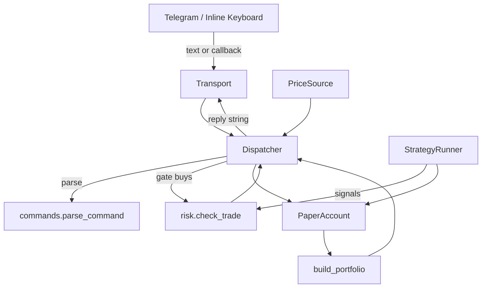

<p align="center">
  
</p>

<h1 align="center">Telegram Crypto Trading Bot</h1>

<p align="center">
  <strong>A Telegram-controlled crypto paper-trading bot — typed command parser, cost-basis &amp; PnL engine, pluggable strategies, and pre-trade risk limits, in pure Python.</strong><br>
  Type <code>/buy BTC 0.5</code>, <code>/pnl</code>, <code>/portfolio</code>, <code>/risk</code> — the transport and inline keyboards are abstracted, so it runs and tests with <em>no Telegram token</em>.
</p>

<p align="center">
  <em>Built and maintained by <a href="https://viprasol.com">Viprasol Tech</a> — Fintech Experts. Full-Stack Builders.</em>
</p>

<p align="center">
  <a href="https://github.com/Viprasol-Tech/telegram-crypto-trading-bot/actions/workflows/ci.yml"></a>
  <a href="LICENSE"></a>
  
  
  
  
  
  <a href="https://t.me/viprasol_help"></a>
  <a href="https://github.com/Viprasol-Tech/telegram-crypto-trading-bot/stargazers"></a>
</p>

---

> ## ⚠️ Disclaimer
> This software is for **educational purposes only** and is **not financial advice**. Cryptocurrency trading is highly volatile and involves substantial risk, including the **total loss of capital**. The included engine is a **paper-trading simulator** — it does not place real orders or touch real funds. Always test thoroughly and comply with each platform's terms and your local laws. **Use at your own risk** — Viprasol Tech assumes no responsibility for your trading results.

---

## ✨ Features

- 💬 **Rich command parser** — `/buy`, `/sell`, `/price`, `/balance`, `/positions`, `/portfolio`, `/pnl`, `/history`, `/risk`, `/help` parsed into typed, validated `Command` objects.
- 🧾 **Cost-basis & PnL engine** — average entry price per symbol, **realized** PnL on sells, **unrealized** mark-to-market PnL, and an immutable `Fill` ledger.
- 📊 **Portfolio view** — one-call `build_portfolio()` snapshot with equity, positions value, total PnL, and total-return %.
- 🛡️ **Pre-trade risk limits** — declarative, validated `RiskLimits` (max order/position notional, max open positions, min cash reserve) enforced **before** any buy touches the account.
- 🔌 **Pluggable strategy runner** — a `Strategy` protocol + `StrategyRunner` that routes every signal through the same risk and account path; ships with `ThresholdStrategy` and `SmaCrossStrategy`.
- ⌨️ **Inline-keyboard interface** — a transport-agnostic `InlineKeyboard` model (main menu, quick-trade, confirm dialogs) that renders to Telegram `reply_markup` and maps taps back to commands.
- 🧱 **Abstracted transport** — a `Transport` protocol with an `InMemoryTransport` fake; runs and tests without a token.
- 🖥️ **CLI subcommands** — `demo`, `chat`, `backtest`, `risk`, `version` — exercise the whole stack from the terminal.
- ⚙️ **Modern tooling** — ruff, mypy (strict), pytest (120 tests), GitHub Actions CI.

## 🚀 Quickstart

```bash
# Clone and install (editable, with dev extras)
git clone https://github.com/Viprasol-Tech/telegram-crypto-trading-bot.git
cd telegram-crypto-trading-bot
pip install -e ".[dev]"

# Run the end-to-end demo (no token, no API keys, no risk)
telegram-crypto-trading-bot demo

# Send your own commands
telegram-crypto-trading-bot chat -m "/buy BTC 1" -m "/pnl" -m "/portfolio"

# Backtest a built-in strategy over a synthetic price path
telegram-crypto-trading-bot backtest --strategy sma --symbol BTC
```

## 🧑‍💻 Usage

Everything is plain Python — the dispatcher takes a parsed command, a price
source, and an optional risk policy, and returns a reply string:

```python
from telegram_crypto_trading_bot.bot import Dispatcher, StaticPriceSource
from telegram_crypto_trading_bot.paper import PaperAccount, build_portfolio
from telegram_crypto_trading_bot.risk import RiskLimits

prices = StaticPriceSource({"BTC": 30_000.0, "ETH": 2_000.0})
account = PaperAccount(cash=100_000.0)
limits = RiskLimits(max_order_notional=50_000.0, max_open_positions=5)

bot = Dispatcher(account, prices, limits=limits)

print(bot.handle_text("/buy BTC 1"))     # BOUGHT 1 BTC @ 30000.00 ...
print(bot.handle_text("/buy ETH 5"))     # BOUGHT 5 ETH @ 2000.00 ...
print(bot.handle_text("/pnl"))           # PnL - realized +0.00 | unrealized ...
print(bot.handle_text("/buy BTC 100"))   # ERROR: rejected by risk policy (...)

# A mark-to-market snapshot any time:
snap = build_portfolio(account, {"BTC": 31_000.0, "ETH": 2_050.0})
print(snap.equity, snap.total_pnl, snap.total_return_pct)
```

Run an automated strategy through the **same** risk + account path:

```python
from telegram_crypto_trading_bot.strategy import StrategyRunner, SmaCrossStrategy

strat = SmaCrossStrategy("BTC", fast=2, slow=4, quantity=1.0)
runner = StrategyRunner(strat, account, limits=limits)

for result in runner.run([{"BTC": 90.0}, {"BTC": 95.0}, {"BTC": 120.0}]):
    print(result.executed, result.detail)
```

Wire up an inline keyboard and handle a button tap:

```python
from telegram_crypto_trading_bot.keyboard import main_menu, quick_trade

reply_markup = main_menu().to_telegram()        # -> Telegram reply_markup dict
reply = bot.handle_callback("cmd:buy BTC 0.5")  # tap -> "/buy BTC 0.5" -> reply
```

## 🏗️ Architecture



## 📋 Command & API Reference

| Command | Result | Notes |
| --- | --- | --- |
| `/buy <SYM> <QTY>` | Market buy | Gated by the active `RiskLimits` |
| `/sell <SYM> <QTY>` | Market sell | Realizes PnL vs. average cost |
| `/price <SYM>` | Current quote | From the `PriceSource` |
| `/balance` | Cash + holdings | Compact one-liner |
| `/positions` | Open positions | Quantity, avg price, cost basis |
| `/portfolio` | Full snapshot | Equity, market value, uPnL, return % |
| `/pnl` | Realized + unrealized PnL | Marked to current prices |
| `/history [N]` | Recent fills | Optional row limit |
| `/risk` | Active limits + usage | Position-count usage shown |
| `/help` | Command reference | Aliases: `/start` |

| Module | Key surface | Purpose |
| --- | --- | --- |
| `commands` | `parse_command`, `Trade`, `History`, ... | Text -> typed commands |
| `paper` | `PaperAccount`, `Fill`, `Portfolio`, `build_portfolio` | Cost basis, PnL, ledger |
| `risk` | `RiskLimits`, `check_trade`, `RiskDecision` | Pre-trade enforcement |
| `strategy` | `Strategy`, `StrategyRunner`, `ThresholdStrategy`, `SmaCrossStrategy` | Pluggable automation |
| `keyboard` | `InlineKeyboard`, `main_menu`, `quick_trade`, `confirm` | Abstracted button UI |
| `bot` | `Dispatcher`, `Transport`, `run_once` | Orchestration + transport |

## 🗺️ Roadmap

- [x] Typed command parser with strict validation
- [x] Paper account with cost basis, realized/unrealized PnL, and fill ledger
- [x] Pre-trade risk limits enforcement
- [x] Pluggable strategy runner with built-in strategies
- [x] Inline-keyboard action interface (abstracted)
- [x] Portfolio snapshot + `/positions /pnl /history /risk` commands
- [x] CLI subcommands (`demo`, `chat`, `backtest`, `risk`)
- [ ] Live Telegram transport adapter (`python-telegram-bot`)
- [ ] Exchange price feeds (read-only market data)
- [ ] Persistent account state (SQLite)
- [ ] Stop-loss / take-profit order types

## ❓ FAQ

**Does this place real trades?**
No. The engine is a paper-trading simulator — every fill executes against a
price you supply. There is no exchange connectivity and no real funds.

**Do I need a Telegram bot token to try it?**
No. The transport is abstracted behind a protocol with an in-memory fake, so the
CLI and tests run with zero credentials.

**How do I add my own strategy?**
Implement the `Strategy` protocol — a `name` attribute and a
`generate(prices, account) -> list[Signal]` method — then hand it to
`StrategyRunner`. Risk checks are applied automatically.

**How are risk limits enforced?**
Every buy passes through `risk.check_trade()` before touching the account; a
breach returns a `RiskDecision` with a human-readable reason and the order is
rejected. Sells (which reduce exposure) are always allowed.

## 🤝 Contributing

Contributions are welcome! Please open an issue to discuss substantial changes
first. Before submitting a PR, make sure the full check suite is green:

```bash
ruff check . && ruff format --check . && mypy src && PYTHONPATH=src python -m pytest -q
```

See [CONTRIBUTING.md](CONTRIBUTING.md) and our [Code of Conduct](CODE_OF_CONDUCT.md).

## Contact — Viprasol Tech Private Limited

- Website: [viprasol.com](https://viprasol.com)
- Email: [support@viprasol.com](mailto:support@viprasol.com)
- Telegram: [t.me/viprasol_help](https://t.me/viprasol_help) | WhatsApp: +91 96336 52112
- GitHub: [@Viprasol-Tech](https://github.com/Viprasol-Tech) | [LinkedIn](https://www.linkedin.com/in/viprasol/) | X [@viprasol](https://twitter.com/viprasol)

## License

[MIT](LICENSE) (c) 2025 Viprasol Tech Private Limited
